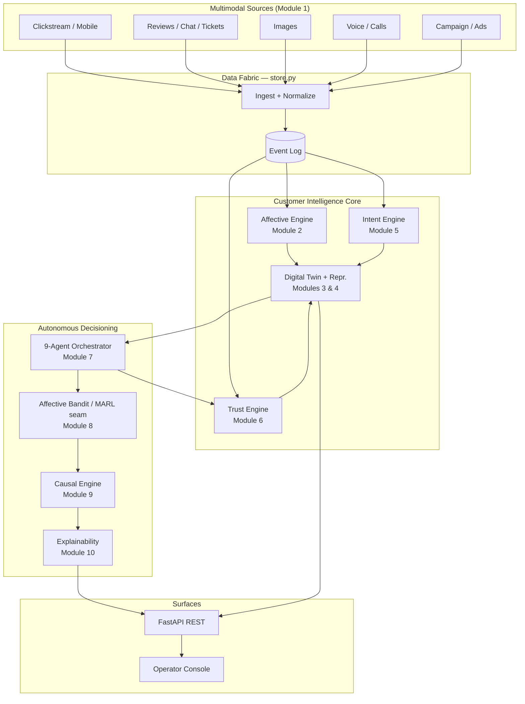
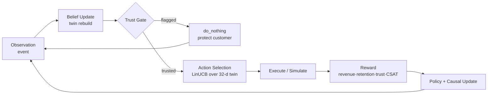
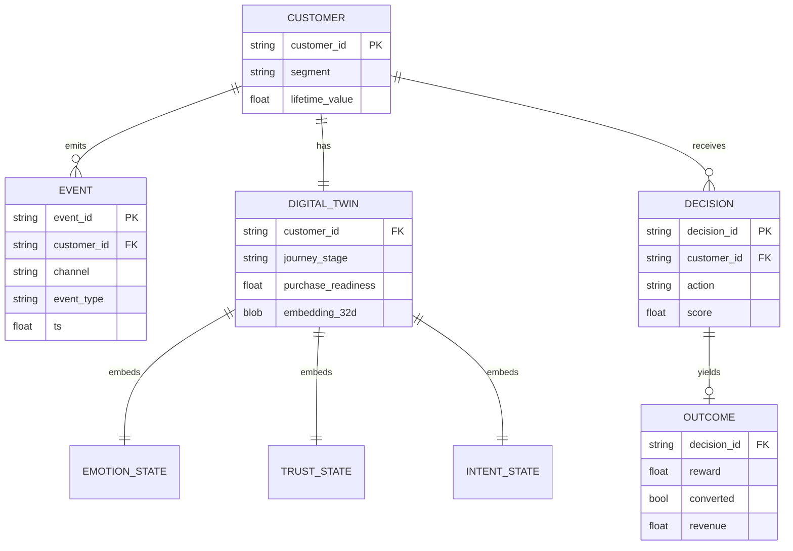
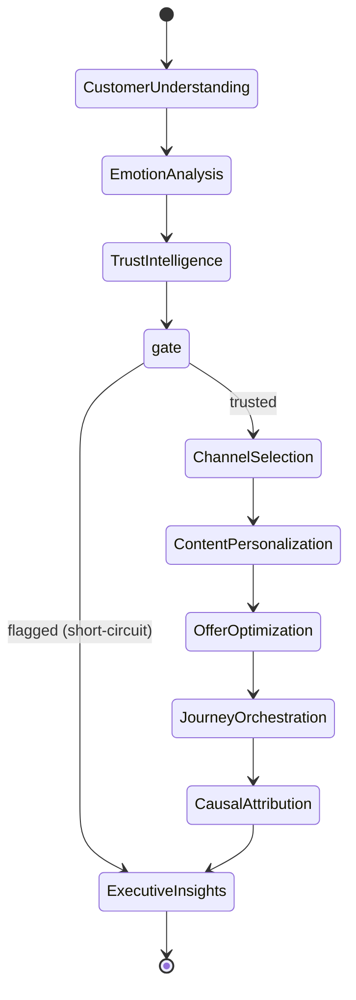
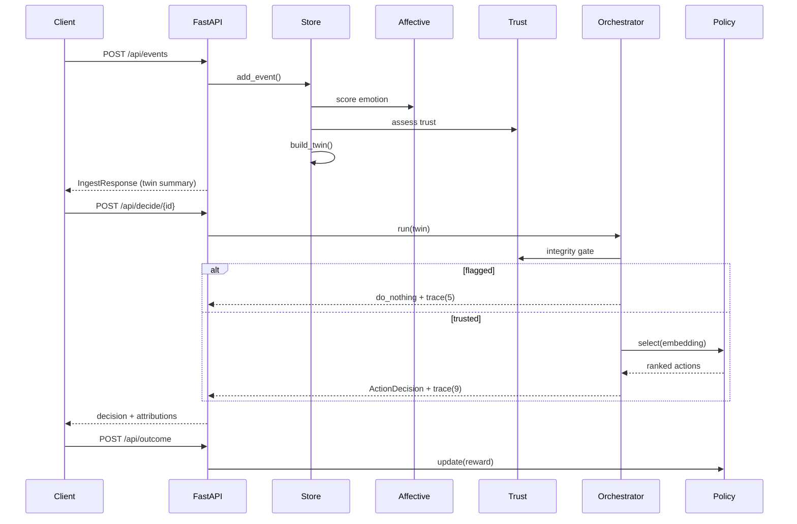

# AdTrust CXAI — Diagrams

All diagrams render natively on GitHub. For local preview use the
[Mermaid Live Editor](https://mermaid.live) or the VS Code Mermaid extension.

---

## 1. System Architecture

---

## 2. POMDP Decision Loop

---

## 3. Entity Relationship (logical)

---

## 4. 9-Agent Workflow (LangGraph-style)

---

## 5. Ingest → Decision Sequence

